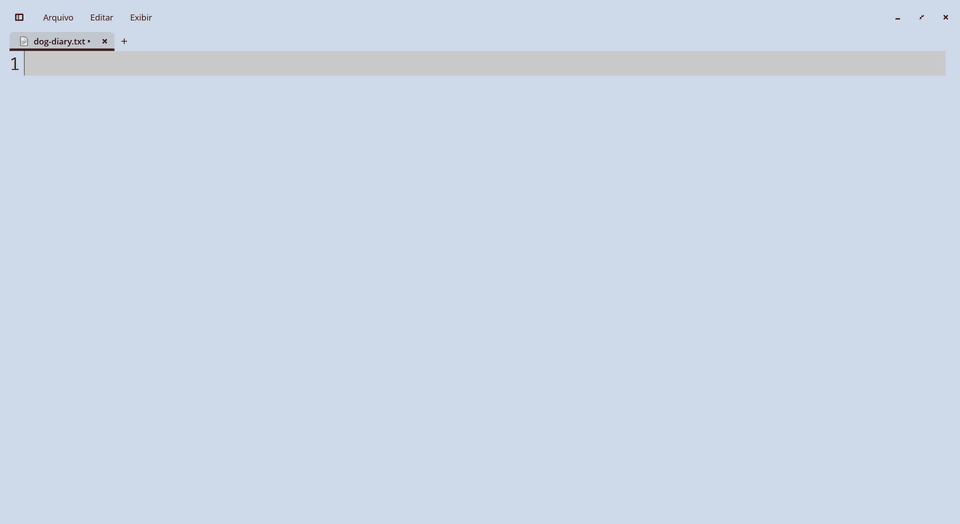

# talk

Ditado por voz 100% local para Linux e Windows. Aperta um atalho, fala, aperta de novo, e
o texto aparece onde o cursor estiver. Nada sai da máquina: sem API key, sem
nuvem, sem assinatura.



*Um ditado de 15 s colado 0,9 s depois de soltar o atalho, numa RTX 3060 de
notebook. Com som: [dog-diary.mp4](docs/demo/dog-diary.mp4) e
[note-to-self.mp4](docs/demo/note-to-self.mp4). A voz é sintética (Piper),
tocada num microfone virtual.*

```
atalho → microfone → Silero VAD → Whisper (whisper.cpp, GPU) → vocabulário → cola no cursor
```

Escrito em Rust. Em repouso o serviço ocupa ~100 MB de RAM e nenhuma VRAM: o
modelo só carrega quando você aperta o atalho, enquanto você fala, e sai da GPU
depois de ocioso.

## Instalação rápida

Um comando, do zero até o serviço rodando (pode rodar de novo para atualizar):

```bash
curl -fsSL https://raw.githubusercontent.com/fioravante-dev/talk/main/scripts/install.sh | bash
```

```powershell
irm https://raw.githubusercontent.com/fioravante-dev/talk/main/scripts/install.ps1 | iex
```

Para instalar com um agente de IA, peça: *"instale o talk seguindo o
AGENTS.md de github.com/fioravante-dev/talk"*. O [AGENTS.md](AGENTS.md) diz o
que ele precisa saber: a placa, o sudo/UAC, os 10 minutos de compilação. Os
passos manuais estão abaixo.

## As peças

| binário | o que é | quando existe |
|---|---|---|
| `talk-rs serve` | o serviço: atalhos, bandeja, colagem, histórico | sempre (autostart) |
| `talk-rs worker` | o único processo que toca na CUDA; termina depois de ocioso | do atalho até `whisper_keep_alive` |
| `talk-ui` | a janela: histórico, vocabulário, ajustes | só enquanto está aberta (no Windows, escondida desde o login) |
| `talk-pill` | a pílula de gravação no rodapé da tela, sem foco | só enquanto grava |
| `talk-start` | só no Windows: sobe o serviço sem console (login, menu Iniciar) | um instante |

O código fica em `crates/`: `talk-core` (config, vocabulário, histórico, o fio
com o trabalhador; tudo testável sem GPU), `talk` (o serviço), `talk-ui`,
`talk-pill` e `talk-bench` (mede o whisper.cpp num corpus de WAVs).

## Os modelos

| papel | modelo | VRAM |
|---|---|---|
| transcrição (padrão) | Whisper large-v3, ggml q5_0 | ~2,2 GB |
| transcrição (mais rápido) | Whisper large-v3-turbo, ggml q8_0 | ~1,3 GB |
| detecção de voz | Silero v5.1.2, ggml | CPU |

Em português o large-v3 q5 ganhou do turbo num teste às cegas; o turbo é ~1,7×
mais rápido. Os dois ficam em `~/.cache/talk/models/` (no Windows,
`%LOCALAPPDATA%\talk\models`, e o instalador já baixa o primeiro):

```bash
mkdir -p ~/.cache/talk/models && cd ~/.cache/talk/models
base=https://huggingface.co
curl -LO $base/ggerganov/whisper.cpp/resolve/main/ggml-large-v3-q5_0.bin
curl -LO $base/ggerganov/whisper.cpp/resolve/main/ggml-large-v3-turbo-q8_0.bin
curl -LO $base/ggml-org/whisper-vad/resolve/main/ggml-silero-v5.1.2.bin
```

## Instalação no Windows

Testado no Windows 11 com uma RTX 5070. Precisa de uma placa NVIDIA RTX
(20xx a 50xx) com o driver atualizado (CUDA 13).

Baixe o `talk-setup-<versão>.exe` em
[Releases](https://github.com/fioravante-dev/talk/releases). Ele instala para o
seu usuário, sem pedir administrador, em `%LOCALAPPDATA%\Programs\talk`. Ele
também baixa os modelos e liga o início no login. Os atalhos:

| tecla | o que faz |
|---|---|
| `Ctrl+Alt+D` | dita, detectando o idioma |
| `Ctrl+Alt+Shift+D` | dita em inglês |

As teclas e o idioma de cada atalho mudam nos Ajustes, e lá também se criam
outros. Valem no aperto seguinte, sem reiniciar. Ficam no `[hotkeys]` do
config; editado à mão, `talk-rs hotkeys` registra de novo. O ícone na bandeja
também começa e termina a ditada. Para desligar o início no login:
`& "$env:LOCALAPPDATA\Programs\talk\talk-rs.exe" autostart off`.

### Compilar no Windows

Precisa de Rust (rustup), Visual Studio 2022 com as ferramentas de C++, CUDA
Toolkit ≥ 12.8 (13 para a RTX 50xx), LLVM e CMake; o Inno Setup 6 só para
gerar o instalador:

```powershell
winget install Rustlang.Rustup LLVM.LLVM Kitware.CMake Nvidia.CUDA
winget install Microsoft.VisualStudio.2022.BuildTools --override "--add Microsoft.VisualStudio.Workload.VCTools --includeRecommended --passive"
.\scripts\build-windows.ps1       # CUDA_ARCH=120 (RTX 50xx); 89 = 40xx, 86 = 30xx
.\scripts\install-windows.ps1     # copia para %LOCALAPPDATA%\Programs\talk e sobe o serviço
.\scripts\package-windows.ps1     # target\dist\talk-setup-<versão>.exe, para RTX 20xx a 50xx
```

Sempre pelo `build-windows.ps1`: ele carrega o ambiente do Visual Studio e as
variáveis do CUDA. Sem isso, o whisper.cpp compila com os bindings do Linux.
Os modelos, se você não usou o instalador:

```powershell
$m = "$env:LOCALAPPDATA\talk\models"; mkdir -Force $m | Out-Null
$hf = "https://huggingface.co"
curl.exe -L -o "$m\ggml-large-v3-q5_0.bin" "$hf/ggerganov/whisper.cpp/resolve/main/ggml-large-v3-q5_0.bin"
curl.exe -L -o "$m\ggml-silero-v5.1.2.bin" "$hf/ggml-org/whisper-vad/resolve/main/ggml-silero-v5.1.2.bin"
```

## Instalação no Linux

Testado em Pop!_OS 24.04 (COSMIC, Wayland) com uma RTX 3060 de 6 GB.

```bash
sudo apt install nvidia-cuda-toolkit clang libclang-dev wl-clipboard libnotify-bin \
  libwebkit2gtk-4.1-dev libgtk-3-dev libgtk-layer-shell-dev
CMAKE_CUDA_ARCHITECTURES=86 cargo build --release   # 86 = RTX 30xx
for b in talk-rs talk-ui talk-pill; do install -m 755 target/release/$b ~/.local/bin/; done
```

Instale como cópia, não como link: recompilar troca o arquivo e o serviço em
execução perderia o trabalhador.

O teclado virtual que cola o texto escreve em `/dev/uinput`. Confira a
permissão com `getfacl /dev/uinput | grep "^user:"`; sem ela:

```bash
echo 'KERNEL=="uinput", MODE="0660", TAG+="uaccess"' | sudo tee /etc/udev/rules.d/80-uinput.rules
sudo udevadm control --reload-rules && sudo udevadm trigger
```

Suba o serviço no login com `~/.config/autostart/talk-rs.desktop`:

```ini
[Desktop Entry]
Type=Application
Name=talk-rs
Exec=sh -c "exec $HOME/.local/bin/talk-rs serve >>$HOME/.cache/talk/talk-rs-serve.log 2>&1"
NoDisplay=true
```

Os atalhos, no COSMIC, se criam e se trocam na janela (Ajustes → atalhos).
Eles vão para os atalhos personalizados do COSMIC, assim:

| tecla | comando |
|---|---|
| `Super+D` | `talk-rs toggle -l auto` |
| `Super+Alt+D` | `talk-rs toggle -l en` |

Fixar `-l pt` num modelo multilíngue faz fala em inglês sair traduzida para o
português; por isso o padrão detecta.

## Configuração

`~/.config/talk/config.toml` (no Windows, `%APPDATA%\talk\config.toml`),
relido a cada ditada:

| chave | padrão | o que faz |
|---|---|---|
| `ggml_model` | `ggml-large-v3-q5_0.bin` | o modelo em `~/.cache/talk/models` |
| `whisper_keep_alive` | `5m` | ocioso por esse tempo, o trabalhador termina e a VRAM volta a 0 (`0`, `30s`, `never`) |
| `language` | vazio | vazio detecta; o `-l` do atalho vence |
| `paste_key` | `ctrl+v` | `ctrl+shift+v` para terminais |
| `input_device` | vazio | o `node.name` do microfone no PipeWire (no Windows, o nome do dispositivo); vazio é o padrão do sistema |
| `[hotkeys]` | só no Windows | `"ctrl+alt+d" = "auto"`: o atalho e o idioma dele |
| `to` | `auto` | `clipboard` só copia; `stdout` só registra no log |
| `update` | `ask` | `ask` avisa da versão nova; `auto` atualiza sozinho com o talk parado; `off` nem procura |

A janela (`talk-ui`, ou "Abrir talk" na bandeja) edita essas chaves sem apagar
os comentários do arquivo.

## Vocabulário

`~/.config/talk/vocab.txt` (no Windows, `%APPDATA%\talk\vocab.txt`), uma linha por termo, relido a cada ditada:

```text
Pop!_OS                       só a dica: o Whisper passa a preferir a grafia
Wayland = Weylend, Uêilend    a dica, e essas grafias viram "Wayland"
```

Os termos viram o `initial_prompt` do Whisper, que guarda só os últimos ~224
tokens: o `vocab` do config vai na frente e os termos do arquivo por último.
Troca só grafias que nunca são palavras de verdade.

## Atualização

Uma vez por dia o talk olha a última release no GitHub. Quando há versão
nova, ele avisa, e a bandeja ganha **Atualizar para x.y.z** (também em
Ajustes → versão, ou `talk-rs update`). O serviço segue ditando enquanto a
atualização trabalha, e reinicia sozinho no fim.

- **Linux, e Windows instalado pelo `install.ps1`:** `git pull` no código de
  onde o talk foi instalado e o instalador de novo, que recompila só o que
  mudou, para a placa daqui. O CUDA, o whisper.cpp já compilado e o modelo
  ficam. Se faltar algum pacote novo, ele não pede senha: avisa para rodar o
  instalador num terminal.
- **Windows instalado pelo `talk-setup`:** se o cuBLAS instalado é do mesmo
  CUDA da release, baixa só os programas (`talk-app-<versão>-cuda<N>.zip`);
  senão, o instalador inteiro, em modo silencioso. Os dois são conferidos
  pelo `.sha256` antes de instalar.

```bash
talk-rs --version          # a versão e o commit: "0.3.0 (7a77b72)"
talk-rs update --check     # só procura
talk-rs update             # atualiza
```

O registro fica em `~/.cache/talk/update.log` (no Windows, `%LOCALAPPDATA%\talk\update.log`).

## Desenvolvimento

```bash
cargo test --release
CMAKE_CUDA_ARCHITECTURES=86 cargo clippy --release --all-targets
talk-ui --dump /tmp/talk-ui      # as telas em HTML, para conferir sem abrir a janela
talk-pill --png /tmp             # os dois estados da pílula em PNG
```

O plano e as medidas da reescrita estão em `docs/plano-rust.md`; o sistema
visual, em `DESIGN.md`.
